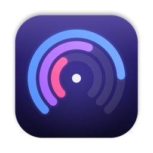
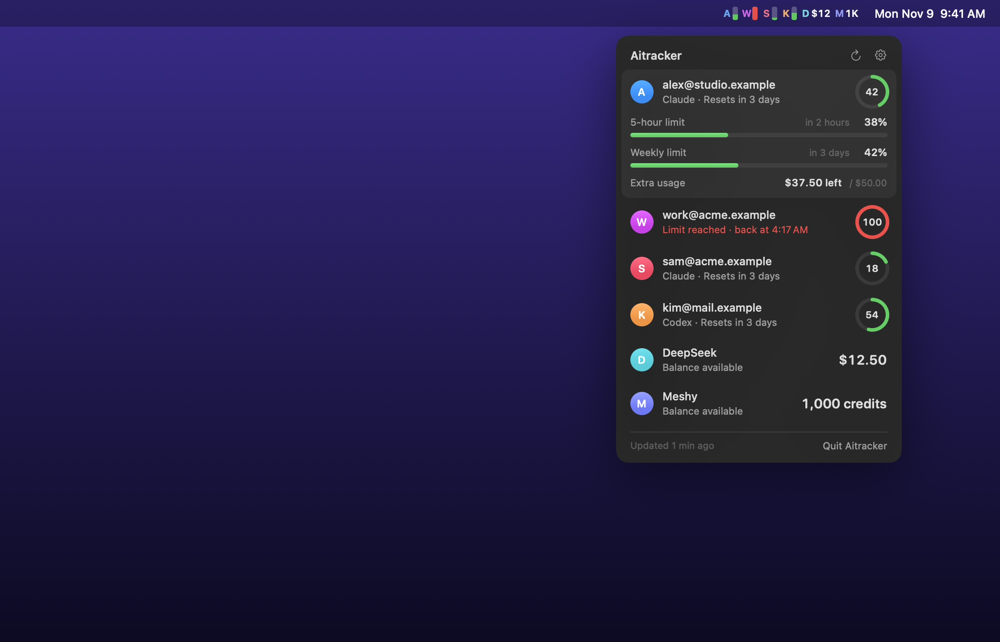

<p align="center">
  
</p>

<h1 align="center">Aitracker</h1>

<p align="center">
  How much of each AI account you've used, at a glance, in the Mac menu bar.
</p>

<p align="center">
  <a href="https://witchmymac.com/aitracker/"><b>witchmymac.com/aitracker</b></a> ·
  <a href="https://github.com/matthfaria96/Aitracker/releases/latest">Latest release</a>
</p>

<p align="center">
  
</p>

Aitracker is a free, native macOS app that shows the limits and credits of all your AI accounts in one place, including several accounts from the same company. Reading your usage costs no tokens and no credits.

## Features

- **Every account side by side.** One fill bar per account in the menu bar, or just an icon if you prefer.
- **The number that matters.** Each account shows its weekly usage. If its 5-hour limit is used up, it shows 100% in red, because the account is blocked right now.
- **Details on click.** 5-hour limit, weekly limit, extra usage and when each one resets.
- **Sign in with your own browser.** Vivaldi, Chrome, Brave, Edge, Arc, Opera, Chromium or Firefox. No embedded browser window.
- **Several accounts, even from one company.** Each one is tracked separately, under its own e-mail.
- **14 languages.** Follows your system language by default, or pick one in the settings.
- **Automatic updates** through Sparkle.
- **No ads, no analytics, no account.** Your keys stay in the macOS Keychain.

## Supported services

| Service | What it shows | How it connects |
|---|---|---|
| **Claude** | 5-hour and weekly limits, extra usage | Your browser session |
| **ChatGPT (Codex)** | Codex 5-hour and weekly limits | The Codex login on your Mac (`codex login`) |
| **Kimi Code** | 5-hour limit, and weekly on plans that have one | The Kimi Code login on your Mac (`kimi login`) |
| **DeepSeek** | Prepaid API balance | API key |
| **Meshy** | 3D credits and monthly renewal | API key |
| **Tripo** | 3D credits and credits reserved by running tasks | API key |

ChatGPT's regular chat has no usage data that can be read, so only Codex limits are available. Kimi's usage endpoint is undocumented and could change. ChatGPT and Kimi each track the one account signed in on your Mac.

## Requirements

macOS 14 (Sonoma) or later, on Apple Silicon or Intel.

## Installation

Pick one:

1. **Terminal, one line (recommended).** Paste this into Terminal:
   ```sh
   curl -fsSL https://witchmymac.com/install.sh | bash -s aitracker
   ```
   It downloads the latest release from GitHub, checks its SHA-256, installs Aitracker in Applications and opens it. There's no macOS warning, because files downloaded by `curl` don't get the "downloaded from the internet" mark. The script is open: [install.sh](https://witchmymac.com/install.sh).
2. **Download the DMG** from [Releases](https://github.com/matthfaria96/Aitracker/releases) or [witchmymac.com](https://witchmymac.com/aitracker/), drag Aitracker to Applications, then allow it once with:
   ```sh
   xattr -dr com.apple.quarantine "/Applications/Aitracker.app"
   ```
3. **Download the DMG** and allow it in System Settings: open the app, click OK on the warning, then go to System Settings › Privacy & Security and click Open Anyway.

The app is free and has no paid developer account behind it, so it isn't notarized by Apple. That's why macOS asks for this once.

## Adding accounts

Open the menu bar panel, click the gear, then **Add Account**.

- **Claude:** click **Open login**. A separate window of your browser opens: sign in there with the account you want, and Aitracker picks it up and closes the window. Do this once per account. The first time, macOS asks to let Aitracker read "<Browser> Safe Storage" from the Keychain, which is needed to decrypt the browser's session. Choose **Always Allow**.
- **An account already signed in to your browser:** you can pick it from the list instead, but that session is shared with the browser, so it stops working if another account signs in there. The separate window doesn't have this problem.
- **If a session ends:** the account turns orange and shows **Reconnect**. Aitracker never shows old numbers as current.
- **ChatGPT (Codex) and Kimi Code:** sign in with their command-line tool, then add the account.
- **DeepSeek, Meshy and Tripo:** paste an API key from your account on each service. The key is only used to read the balance.

## Privacy

Aitracker talks only to the services you add, to witchmymac.com and GitHub for updates, and to public status pages. Session keys and API keys are stored in the macOS Keychain. Your browser's cookie database is only read, and only for the session cookie of the service you're adding.

## Building

Requires Xcode 27.

```sh
xcodebuild -project "Claude Usage.xcodeproj" -scheme "Claude Usage" -configuration Release \
  -derivedDataPath build/DerivedData CODE_SIGN_IDENTITY=- DEVELOPMENT_TEAM= build
```

`scripts/package-release.sh` makes the universal build that goes to Releases.

## Credits and license

Aitracker is a fork of [Claude Usage Tracker](https://github.com/hamed-elfayome/Claude-Usage-Tracker) by Hamed Elfayome and contributors, and is distributed under the same **MIT License** (see [LICENSE](LICENSE)). It isn't affiliated with Anthropic, OpenAI, Moonshot AI, DeepSeek, Meshy or Tripo.
